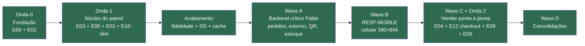

# Onde estamos — mapa simples do projeto Leela

> Este arquivo é a visão "de helicóptero". O detalhe operacional vive em [[V1-KANBAN]] (colunas), [[V1-CHECKLIST]] (tasks) e [[ROADMAP]] (§4 épicos, §5 ondas). **A terminologia e a hierarquia oficial estão em [[MODELO-ROADMAP]].**

## Glossário em 6 palavras (para não se perder)

| Palavra | O que significa | Analogia |
|---|---|---|
| **Onda** | Uma leva de entregas que vai ao mercado junta (Onda 0 Fundação → 1 Operar → 2 Vender → 3 App → 4 Comunidade). É o "quando entrega". | Os andares de um prédio, construídos de baixo para cima. |
| **Épico** | Uma capacidade do produto (ex.: E12 = landing + checkout). É o "o quê". | Um cômodo do andar. |
| **User Story** | Uma fatia de valor para uma pessoa, com um Job To Be Done. | Um móvel do cômodo. |
| **Task** | Um pedaço técnico = 1 PR. | Um parafuso do móvel. |
| **Lote de execução** ("Wave A-D") | Um punhado de tasks que o time despachou numa mesma sprint. **Não é uma Onda** — é só agenda. | Uma diária de obra. |
| **Horizonte (H1-H4)** | Quão longe no futuro (H1 = agora, H4 = visão de 3-5 anos). | O projeto de expansão do bairro. |

> ⚠️ **O que confundia:** os cards misturavam "Wave" (agenda) com "Onda" (release). Agora: **"Wave C" é a mesma coisa que "Onda 2"** — daqui pra frente falamos só de Onda. Detalhe e de-para em [[MODELO-ROADMAP]].

## A história em 4 linhas

1. **Já construímos** a fundação (monorepo, Firebase, Design System) e o **núcleo do painel do organizador**: operação de eventos, clubes, dashboard e multi-tenant. Isso foi a Onda 0 + Onda 1 — **fechadas com gate PASS**.
2. Depois veio um bloco grande de **acabamento**: fidelidade visual das 6 telas de evento, showroom do Design System, cache de dados (TanStack Query) e destrave do firebase-admin. **Tudo concluído.**
3. A trilha next-trail (2026-07-10/11) **terminou**: Wave A (backend crítico em Fable) e Wave B (mobile real 390×844) fechadas com gates.
4. **A Onda 2 · Vender foi EXECUTADA por inteiro em 2026-07-12/13**: página de vendas com lotes por modalidade e cupons, checkout público de 5 etapas, estorno digno por inscrito, estoque por tamanho, comunicação/campanhas, equipe com 4 papéis, repasses ponta a ponta (organizador solicita, admin aprova/paga com auditoria LGPD), telas de sistema 404/403/500, e a dívida técnica (ex-Wave D) junto — inclusive dados ao vivo (onSnapshot) no Financeiro e no balcão, provados de ponta a ponta. **Próximo: decisões do Vitor + Onda 3** (app do atleta, assessorias parceiras E18, link-in-bio E17).

## Você está aqui

Verde = feito. **Tudo acima está verde (2026-07-13): a Onda 2 fechou.** O que vem agora é a **Onda 3** (app do atleta E13-slim, assessorias parceiras E18, link-in-bio E17) — mais as decisões abertas do Vitor listadas no [[V1-KANBAN]] e no HANDOFF.

## O que foi a Wave A e por que ela veio primeiro

É o backend que faltava por trás das telas que já existem. As telas pousaram honestas (EmptyState onde não havia dado); a Wave A cria o dado real. Roda em **Fable** porque é dinheiro e segurança.

| Frente | O que entrega | Destrava o quê | Estado |
|---|---|---|---|
| **FABLE-A** | Kernel `pedidos` (compra em grupo: 1 pagador, N inscritos — ADR-011) | Painel do inscrito com pagamento real (S203) · Financeiro por forma de pagamento (S207) · o checkout da Onda 2 escreve NESSA coleção | 🔨 **A-T1 em execução agora** |
| FABLE-B | Estorno por inscrito, idempotente | Botão "Reembolsar" de verdade | depende de A |
| FABLE-C | Validação do QR no servidor | Check-in seguro (anti-fraude) | independente, na fila |
| FABLE-E→D | Estoque de kit por tamanho | Tela de Estoque real; mata a dor "kit errado" | depende de A |
| FABLE-F | Cronograma de entrega + chips | Banner "Entrega ativa · Dia N de M" no balcão | independente, na fila |
| FABLE-G | Log de comunicações | Abas Comunicação/Histórico do inscrito + campanhas (E06) | depende de A |

**FABLE-A é o pino central**: B, D e G dependem dele, e a Onda 2 (checkout E12) consome a mesma coleção `pedidos` — por isso ele nasce uma vez só, agora (decisão D1).

## O que vem depois (já decidido, ordem travada)

- **Wave B — RESP-MOBILE**: hoje o painel é desktop; 7 defeitos MAJOR no celular têm uma causa-raiz única (o shell). Um sweep conserta tudo: menu vira drawer, KPIs em 1 coluna, tabelas em modo card. Decisão D5: é obrigatório para a V1.
- **Wave C — Onda 2 "vender ponta a ponta"**: configuração de vendas (E04-slim), landing pública com checkout (E12, gateway **Asaas**), repasses ao organizador (E09-slim), telas de erro (E07-web) e campanhas de comunicação (E06). Fecha o ciclo: *atleta descobre → inscreve → paga → organizador vê receita*.
- **Wave D — Consolidações**: dívidas pequenas (componente KPI canônico, teste flaky, bugs do showroom). Entram nos intervalos.

## Épicos — quadro geral (do ROADMAP §4)

| Épico | Nome curto | Situação |
|---|---|---|
| E00 Fundação · E01 Design System | base técnica e visual | ✅ feitos (Onda 0) |
| E03 Operação do evento · E05 Clubs · E02 Dashboard · E16-slim Plataforma | núcleo do painel | ✅ feitos (Onda 1) — E03 recebe agora a trilha Fable A-G |
| E04-slim Vendas · E12 Landing+checkout · E09-slim Repasses · E07-web Erros · E06 Comunicação | vender ponta a ponta | 📋 Wave C (Onda 2), planejada em 23 lotes/71 tasks |
| E13 App do atleta | mobile do atleta | 🔜 Onda 4 (V1.5: E13-slim + GymRats) |
| 🆕 E18 Assessorias parceiras | tração B2B (clubes parceiros c/ desconto) | 📋 Onda 3 · planejado 2026-07-12 |
| 🆕 E17 Perfil social / link-in-bio | perfil `@handle` + Feed·Eventos·Clubs + tema por-conta | 📋 Onda 3 (link público) / Onda 4 (in-app) |
| E08 Influenciador · E10 Marcas · E11 Analytics · E14 Treino · E15 Creator Studio | expansão | ❄️ fora da V1 / adiados |

## Ações que só o Vitor pode fazer (não bloqueiam hoje, mas têm fila)

- **KYC do Asaas** — cadastro no gateway tem prazo de análise; quanto antes iniciar, melhor (a task de produção `E04-PAY-T2` fica estacionada até sair).
- **OAuth da Strava** — registrar o app (semanas de lead time); só importa para a V1.5 (E13).
- Domínio público da Leela + e-mail transacional/de suporte — precisa existir antes do checkout ir ao ar.
