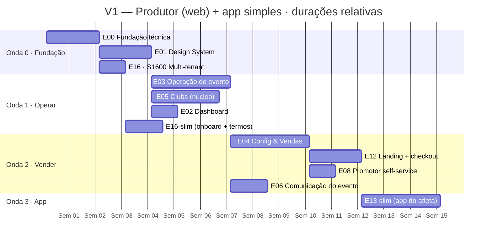
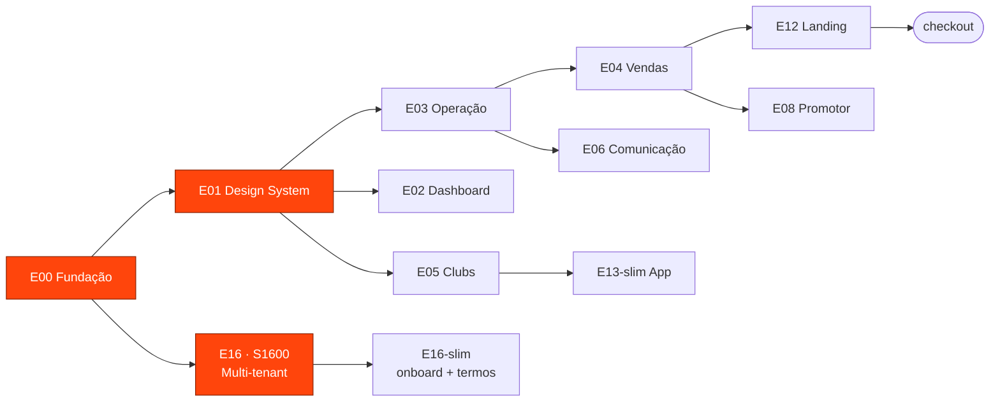
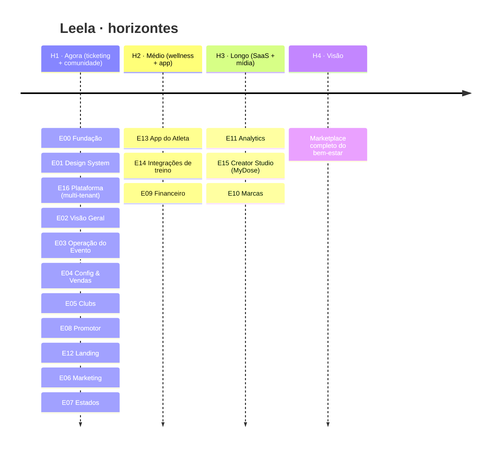
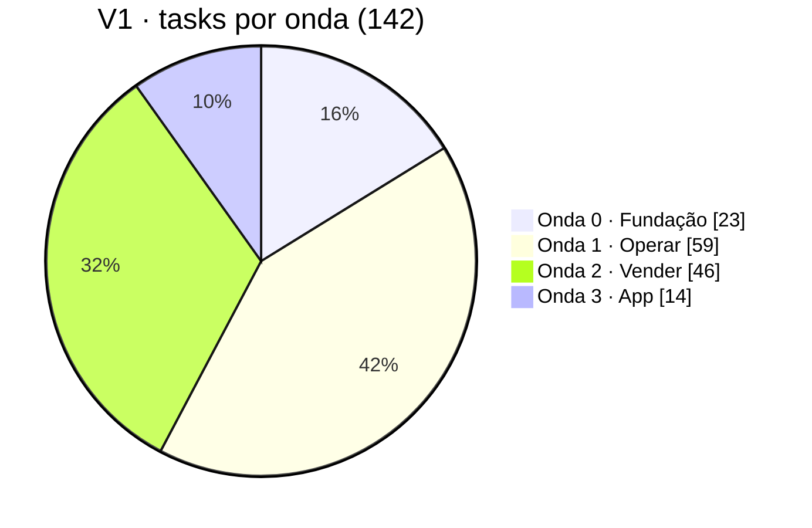

# 📊 Leela · Roadmap visual

> Diagramas Mermaid (o Obsidian renderiza nativamente). **As durações são ilustrativas/relativas** (baseadas no tamanho T-shirt dos épicos), não um cronograma com datas reais. Fonte: [[ROADMAP]], [[V1-PRODUTOR-web]], [[V1-CHECKLIST]].

## Gantt — Fatia V1 (produtor web + app simples)

## Fluxograma — dependências dos épicos da V1

## Timeline — roadmap completo por horizonte (17 épicos)

## Progresso da V1 (pie — ilustrativo)

---
Voltar: [[HOME]] · [[ROADMAP]] · [[V1-CHECKLIST]]
