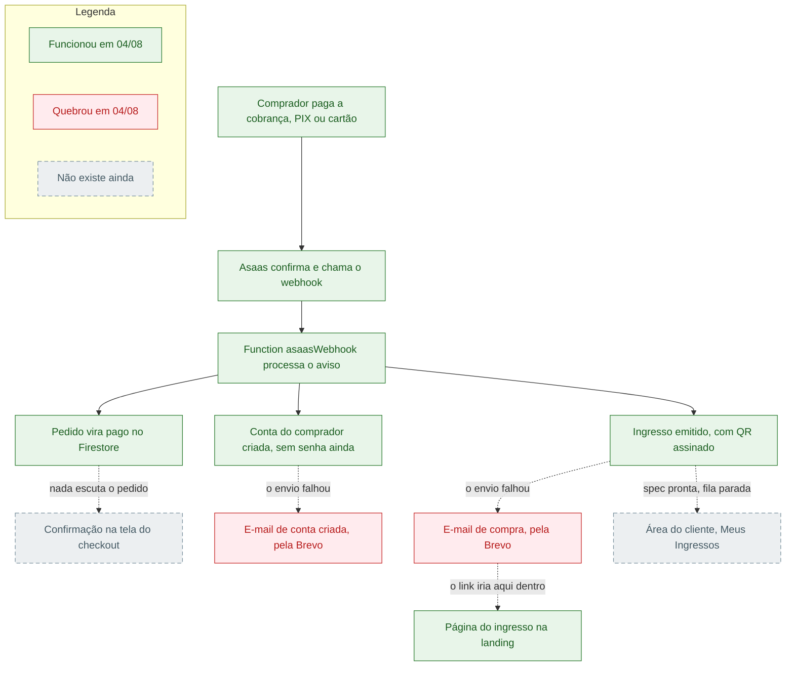

# Leela · fluxo pós-pagamento, com o estado real de cada elo

Registro do que acontece depois que alguém paga uma inscrição na Leela, escrito para o dono e o sócio. Cada elo do caminho está marcado com o estado medido no diagnóstico de 04/08/2026, o dia do primeiro pagamento real: funcionou, quebrou, ou ainda não existe. Nada aqui é fluxo imaginado. A fonte de cada afirmação é o report do diagnóstico, linkado no rodapé.

A frase que resume o documento: o backend funcionou de ponta a ponta em cerca de dez segundos, o e-mail era o único canal que contava isso ao comprador, e ele quebrou.

## O fluxograma

A página do ingresso está verde porque existe e funciona. O problema é que o único caminho até ela é o link que vai dentro do e-mail de compra, e o e-mail não saiu.

## O caminho, elo a elo

**1 · Cobrança e pagamento.** O checkout cria a cobrança no Asaas, o comprador paga no banco dele. Sistema externo: Asaas. No teste real de 04/08, a cobrança nasceu e foi paga em cerca de dois minutos. Estado: funcionou.

**2 · Aviso do Asaas.** O Asaas mantém um webhook registrado apontando para a function `asaasWebhook`. Pagamento confirmado, aviso disparado. A fila do Asaas estava saudável, sem represamento e sem penalidade. Estado: funcionou, com o aviso chegando segundos depois do pagamento.

**3 · Processamento do webhook.** A function recebe o aviso, valida e faz três coisas na sequência: marca o pedido como pago, cria a conta sem fricção do comprador e emite os ingressos. Código: `functions/src/checkout/webhookAsaas.ts`. Quando o Asaas reentrega o mesmo evento, a function reconhece a duplicata e não faz nada de novo. Estado: funcionou, incluindo a idempotência.

**4 · Pedido pago e conta criada.** O pedido no Firestore vira `status: "pago"` e a conta do comprador nasce vinculada à pessoa, pronta para receber senha no primeiro acesso. Código da conta: `functions/src/checkout/contaSemFriccao.ts`. Estado: funcionou. O registro do pedido guarda, honesto, `emailStatus: "falha_envio"`.

**5 · Emissão do ingresso.** O inscrito vira `confirmado`, ganha um código legível por humanos e um QR assinado, que é a prova de posse. Código: `functions/src/eventos/emitirIngressos.ts`, com a guarda do chaveiro de assinatura em `webhookAsaas.ts`. Estado: funcionou. O ingresso do dono existe em produção agora, código `T93N7F`.

**6 · E-mail de compra e e-mail de conta.** Dois envios pela Brevo: um com os ingressos e o link da página de cada um, outro avisando da conta nova. O link é montado em `functions/src/eventos/basePublica.ts`. Estado: quebrou. Os dois envios levaram HTTP 401 da Brevo antes de qualquer aceitação, então nenhuma mensagem chegou a entrar na fila de envio. A causa está na seção do incidente.

**7 · Página do ingresso.** A rota `/ingresso/{token}` na landing abre sem login e mostra QR, código e o essencial. Código: `apps/landing/app/(public)/ingresso/[token]/page.tsx`. Estado: funciona, mas ficou inalcançável neste incidente, porque o token que compõe o link só viaja dentro do e-mail.

**8 · Confirmação na tela do checkout.** Não existe. A tela do checkout não tem listener nem polling do pedido, e as regras do Firestore hoje proíbem o comprador de ler o próprio pedido. Essa abertura é um TODO explícito nas rules, marcado E12, para ser feita com a story do checkout (`firestore.rules`, região das linhas 2528 a 2543). Com gateway real, a tela fica no QR com "Pagamento pendente" para sempre, enquanto a copy promete que "a confirmação chega sozinha, em segundos" (`StepPagamento.tsx`). Quem cumpriria a promessa era o e-mail.

**9 · Área do cliente.** Não existe. A landing tem sete páginas públicas e nenhuma autenticada de comprador. A área foi especificada na virada de 03 para 04/08: "Meus Ingressos" é a S1222 e o primeiro acesso com definição de senha é a S1223, ambas em `../02-rodadas/2026-08-02-retomada/11-fila-contas-e-area-cliente.md`. A fila não foi executada.

## O incidente de 04/08

Uma correção de premissa antes da linha do tempo. O pagamento que se acreditava ser o do teste, `pay_6e37hktx4xld12qf`, nunca foi pago: é uma cobrança de QA de 03/08 que segue pendente no Asaas. O que o dono pagou foi uma cobrança nova, `pay_jay08p0u1qlz11r2`, nascida de um checkout novo feito por ele em 04/08 no evento `teste-taxa-repassada`, R$ 11,05. Mesmo cliente, mesmo evento, e-mail do dono no pedido: a compra é dele, verificado por API e Firestore.

Linha do tempo, em horário de Brasília:

| Hora | O que aconteceu |
|---|---|
| 15:57:44 | Pedido criado com os aceites, no checkout novo do dono |
| entre 15:57 e 15:59 | Cobrança criada no Asaas; o dono paga o PIX no banco |
| 15:59:53 | O webhook do Asaas chega na function |
| 16:00:01 | Conta do comprador criada; o e-mail dela falha com 401 da Brevo; pedido vira pago |
| 16:00:03 | Ingresso `T93N7F` emitido, com QR assinado |
| 16:00:04 | O e-mail dos ingressos falha com o mesmo 401; a function responde 200 |
| 16:00:30 | Segunda entrega do Asaas tratada como duplicada, sem efeito |

Do pagamento ao ingresso emitido: cerca de dez segundos.

**Causa raiz nº 1, o elo que quebrou.** A conta da Brevo está com a trava de IPs autorizados ativa. As Cloud Functions da Leela são de primeira geração e saem para a internet com IP dinâmico, que muda sem aviso. Qualquer IP fora da lista leva 401 antes mesmo de a Brevo olhar a mensagem. A chave é válida; a trava é da conta. O diagnóstico reproduziu o 401 fora do GCP no mesmo dia, com a chave de produção, e a própria resposta da Brevo aponta a tela `app.brevo.com/security/authorised_ips`. Essa trava já tinha sido dada como destravada antes; em 04/08 estava ativa de novo, ou nunca tinha saído de fato.

**Causa raiz nº 2, o silêncio das outras superfícies.** As duas telas que teriam segurado a falha do e-mail não existem: o checkout não reage à confirmação e a área do cliente não foi construída. Com o e-mail quebrado, as três superfícies de retorno caíram juntas. O dono pagou, o sistema entregou, e nenhum canal contou isso a ele.

**A distinção que importa para o registro.** O que foi desenhado e falhou: o e-mail, único canal de entrega construído até hoje. O que nunca foi desenhado como código, mas já foi pensado e especificado: a confirmação na tela do checkout (TODO E12 nas rules, story prevista) e a área do cliente (specs S1222 e S1223, prontas desde 04/08, fila parada). Não é que ninguém pensou no fluxo; é que o e-mail era o único fio, e ele arrebentou.

## Lacunas e o status de decisão de cada uma

| # | Lacuna ou ação | Decisão |
|---|---|---|
| 1 | Desativar a trava de IPs autorizados na conta Brevo, pelo dashboard | Ação do dono, registrada no painel como BREVO-1. A alternativa para manter a trava é dar IP fixo às functions (VPC connector com Cloud NAT); essa é decisão de custo de infraestrutura e vai ao CTO humano, não ao dono |
| 2 | Reenviar os dois e-mails represados deste pedido; hoje não existe ferramenta de reenvio | Técnica, resolve na esteira sem subir ao painel |
| 3 | Tela do checkout passa a detectar a confirmação (abrir a leitura do próprio pedido nas rules e escutar o pedido na tela) | Técnica, a story já estava prevista no TODO E12 |
| 4 | Executar a fila da área do cliente, S1222 e S1223 | O dono só prioriza a ordem, registrada no painel como POSPAG-1; o conteúdo já está decidido nas specs |
| 5 | Falha de e-mail transacional vira incidente com alerta, não linha de log | Técnica |
| 6 | Deixar a cobrança de QA pendente vencer em 05/08 e conferir a expiração no pedido | Técnica, observação apenas |

## Proveniência

Escrito em 2026-08-04, na tarde do incidente. Trace `leela-pixreal-diag-20260804`, lane DOC-FLUXO-PAGAMENTO. Fonte da verdade: [report completo do diagnóstico](../../.nirvana/outputs/leela-pixreal-diag-20260804/DIAG-PIXREAL-REPORT.md), lane DIAG-PIXREAL, investigação somente leitura feita no mesmo dia. O token QR do ingresso não aparece neste documento de propósito: ele é a prova de posse do ingresso (RN-218).
